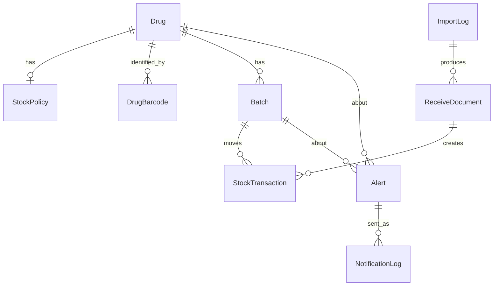

# MedStock Alert

ระบบบริหารคลังยาและแจ้งเตือนอัตโนมัติผ่าน LINE สำหรับ **คลังยา OPD โรงพยาบาลสุราษฎร์ธานี**

ออกแบบสำหรับเภสัชกรผู้ใช้งานคนเดียว: รับยาเข้าด้วย CSV หรือบาร์โค้ด ตรวจสต็อกทุกวัน และส่งสรุปเข้า LINE


> **ฐานโปรเจกต์:** รวมจาก MedStock-Alert1 (Models + AlertEngine) และ MedStock-Alert (Login + Dashboard)
>
> **สถานะปัจจุบัน:** โครงสร้างโปรเจกต์, โมเดลข้อมูล, ฐานข้อมูล, กฎแจ้งเตือน, **ระบบ Login + Authorize**, และหน้า Dashboard (UI) เสร็จแล้ว  
> ส่วนที่ยังไม่ทำ: ดึงข้อมูลจริงเข้า AlertEngine, LINE Messaging API, Scheduler, นำเข้า CSV, บาร์โค้ด

---

## สารบัญ

- [ฟีเจอร์](#ฟีเจอร์)
- [Tech Stack](#tech-stack)
- [โครงสร้างโปรเจกต์](#โครงสร้างโปรเจกต์)
- [เริ่มต้นใช้งาน](#เริ่มต้นใช้งาน)
- [การตั้งค่า](#การตั้งค่า)
- [ระบบยืนยันตัวตน (Authentication)](#ระบบยืนยันตัวตน-authentication)
- [โมเดลข้อมูล](#โมเดลข้อมูล)
- [กฎการแจ้งเตือน](#กฎการแจ้งเตือน)
- [หน้า Dashboard](#หน้า-dashboard)
- [การนำเข้าข้อมูล](#การนำเข้าข้อมูล)
- [การตั้งค่า LINE](#การตั้งค่า-line)
- [การทดสอบ](#การทดสอบ)
- [ความปลอดภัยและ PDPA](#ความปลอดภัยและ-pdpa)
- [Roadmap](#roadmap)
- [รายการรอข้อมูลจากเจ้าหน้าที่](#รายการรอข้อมูลจากเจ้าหน้าที่)
- [License](#license)

---

## ฟีเจอร์

- รับยาเข้าด้วยไฟล์ **CSV** (มีหน้า Preview) หรือ **สแกนบาร์โค้ด**
- สต็อกระดับ **ล็อต** พร้อมสมุดบัญชีเคลื่อนไหว (ledger) ตรวจย้อนหลังได้
- แจ้งเตือน **ยาใกล้หมดอายุ / หมดอายุแล้ว** หลายระดับ (180 / 90 / 30 วัน)
- แจ้งเตือน **จุดสั่งซื้อ** กำหนด Min / Max / Reorder Point รายยา พร้อมแนะนำปริมาณสั่งซื้อ
- แจ้งเตือน **ยาค้างสต็อก** กำหนดเกณฑ์ได้ทั้งค่ากลางและรายยา
- **LINE** เป็นศูนย์รวมการแจ้งเตือน (สรุปรายวัน + แจ้งด่วน)
- จ่ายตามหลัก **FEFO** (หมดอายุก่อนจ่ายก่อน)
- **ระบบ Login + Cookie Authentication** พร้อม Global Authorize Filter

---

## Tech Stack

| ส่วน | เทคโนโลยี | หมายเหตุ |
|------|-----------|----------|
| Backend | ASP.NET Core 8 (MVC) | โปรเจกต์เดียว |
| ORM | Entity Framework Core 8 | |
| Database | SQL Server (Express) | เปลี่ยนเป็น PostgreSQL ได้ถ้าโรงพยาบาลต้องการ |
| Auth | Cookie Authentication + `[Authorize]` | Global filter + `[AllowAnonymous]` |
| Test | xUnit | |
| LINE | Messaging API | LINE Notify ยุติบริการแล้ว (ยังไม่ได้ทำ) |
| Barcode | USB scanner + ZXing-js | ยังไม่ได้ทำ |
| CSV | CsvHelper | ยังไม่ได้ทำ |
| Jobs | BackgroundService | ยังไม่ได้ทำ |

---

## โครงสร้างโปรเจกต์

```
MedStockAlert/
├── MedStockAlert.sln
├── MedStockAlert/
│   ├── Controllers/
│   │   ├── AccountController.cs      ← Login / Logout / AccessDenied
│   │   └── HomeController.cs         ← Dashboard ([Authorize])
│   ├── Data/
│   │   └── AppDbContext.cs
│   ├── Filters/
│   │   └── AuthorizeFilter.cs        ← Global filter บังคับล็อกอิน
│   ├── Migrations/
│   ├── Models/                       ← Entity 10 ตัว + Enums.cs
│   ├── Services/
│   │   ├── Alerts/                   ← AlertEngine, AlertReconciler, DigestBuilder...
│   │   ├── IAuthService.cs
│   │   └── AuthService.cs            ← ตรวจสอบ credentials (mock + พร้อมต่อ DB)
│   ├── Views/
│   │   ├── Account/
│   │   │   ├── Login.cshtml
│   │   │   └── AccessDenied.cshtml
│   │   ├── Home/
│   │   │   ├── Dashboard.cshtml
│   │   │   └── Index.cshtml
│   │   └── Shared/
│   │       └── _Layout.cshtml
│   ├── wwwroot/
│   │   └── css/
│   │       └── site.css
│   ├── appsettings.json
│   └── Program.cs                    ← ลงทะเบียน Auth + Global Filter
├── tests/
│   └── MedStockAlert.Tests/
├── docs/
│   └── sample-import.csv
├── .gitignore
└── README.md
```

---

## เริ่มต้นใช้งาน

**ความต้องการ:** .NET 8 SDK (หรือใหม่กว่า), SQL Server Express (หรือ SQL Server 2019+), Visual Studio 2022 (ไม่บังคับ)

```bash
# 1. โคลนโปรเจกต์
git clone https://github.com/maybe213/MedStock-Alert.git
cd MedStock-Alert

# 2. แก้ ConnectionStrings:Default ใน MedStockAlert/appsettings.json ให้ตรงกับเครื่อง

# 3. restore + build + ทดสอบ
dotnet build MedStockAlert.sln
dotnet test MedStockAlert.sln

# 4. สร้างฐานข้อมูลจาก migration
dotnet ef database update --project MedStockAlert

# 5. รันเว็บ
dotnet run --project MedStockAlert --launch-profile http
```

เปิด <http://localhost:5080>

ระบบจะพาไปหน้า **Login** อัตโนมัติ (เพราะมี Global Authorize Filter)

### บัญชีทดสอบ (ช่วงพัฒนา)

| ชื่อผู้ใช้     | รหัสผ่าน       | บทบาท       |
|----------------|----------------|--------------|
| `pharmacist`   | `MedStock@2026`| Pharmacist   |
| `admin`        | `Admin@2026`   | Admin        |

> **หมายเหตุ**
> - ถ้ายังไม่มีเครื่องมือ EF: `dotnet tool install --global dotnet-ef`
> - เมื่อแก้ Entity แล้วต้องสร้าง migration ใหม่: `dotnet ef migrations add <ชื่อ> --project MedStockAlert`
> - ให้รันผ่าน `dotnet run` หรือ F5 ใน Visual Studio ไม่ใช่รัน `.exe` ในโฟลเดอร์ `bin` โดยตรง

---

## การตั้งค่า

`MedStockAlert/appsettings.json`

```json
{
  "ConnectionStrings": {
    "Default": "Server=.\\SQLEXPRESS;Database=MedStockAlert;Trusted_Connection=True;TrustServerCertificate=True"
  },
  "Line": {
    "ChannelAccessToken": "",
    "ChannelSecret": "",
    "PharmacistUserId": ""
  }
}
```

- ปรับ `Server=` ให้ตรงกับชื่ออินสแตนซ์ SQL Server ของเครื่อง
- **ห้าม commit Token / Secret / รหัสผ่านจริงลง Git** ใช้ User Secrets หรือ environment variable แทน

### ค่าตั้งต้นใน `SystemSettings`

| Key | ค่าเริ่มต้น | ความหมาย |
|-----|-------------|----------|
| `DailyDigestTime` | 07:30 | เวลาส่งสรุปรายวัน |
| `ExpiryWarnDays` | 180,90,30 | ระดับเตือนใกล้หมดอายุ (วัน) |
| `BlockDispenseWithinDays` | 30 | งดจ่ายเมื่อเหลืออายุไม่เกิน (วัน) |
| `DefaultSlowMovingDays` | 90 | เกณฑ์ยาค้างสต็อก (วัน) |
| `DefaultLeadTimeDays` | 7 | ระยะเวลาสั่งซื้อเริ่มต้น (วัน) |
| `RepeatCriticalEveryDays` | 1 | เตือนซ้ำเรื่องวิกฤต (วัน) |
| `RepeatNormalEveryDays` | 7 | เตือนซ้ำเรื่องทั่วไป (วัน) |

---

## ระบบยืนยันตัวตน (Authentication)

### ภาพรวม

- ใช้ **Cookie Authentication** ของ ASP.NET Core
- มี **Global Authorize Filter** (`AuthorizeFilter`) บังคับล็อกอินทุกหน้า
- หน้า Login / AccessDenied ใส่ `[AllowAnonymous]`
- Controller ที่ต้องการป้องกันใส่ `[Authorize]` (หรือพึ่ง Global filter)

### ไฟล์ที่เกี่ยวข้อง

| ไฟล์ | หน้าที่ |
|------|---------|
| `Program.cs` | ลงทะเบียน Cookie Auth + Global `AuthorizeFilter` |
| `Filters/AuthorizeFilter.cs` | ตรวจ `IsAuthenticated` แล้ว redirect ไป Login |
| `Services/IAuthService.cs` | Interface ตรวจสอบ credentials |
| `Services/AuthService.cs` | Implementation (mock users + พร้อมต่อตาราง Users) |
| `Controllers/AccountController.cs` | Login / Logout / AccessDenied |
| `Controllers/HomeController.cs` | `[Authorize]` บน Dashboard |

### การทำงาน

1. ผู้ใช้เข้าเว็บ → ยังไม่ล็อกอิน → ถูก redirect ไป `/Account/Login`
2. กรอก username/password → `AuthService.ValidateCredentialsAsync`
3. สำเร็จ → สร้าง Claims (NameIdentifier, Name, Role) → `SignInAsync` (Cookie)
4. Cookie มีอายุ 8 ชั่วโมง (หรือ 14 วันถ้าเลือก "จดจำฉันไว้")
5. Logout → `SignOutAsync` → กลับหน้า Login

### เปลี่ยนไปใช้ฐานข้อมูลจริง

ใน `AuthService.cs` มี TODO ไว้แล้ว:

```csharp
// var dbUser = await _db.Users.FirstOrDefaultAsync(u => u.Username == username && u.IsActive);
// if (dbUser != null && VerifyPassword(password, dbUser.PasswordHash))
//     return (dbUser.Id, dbUser.Username, dbUser.Role);
```

แนะนำใช้ **ASP.NET Core Identity** หรืออย่างน้อย BCrypt / PasswordHasher เมื่อขึ้น production

---

## โมเดลข้อมูล



| ตาราง | หน้าที่ |
|-------|---------|
| `Drugs` | ข้อมูลหลักของยา |
| `DrugBarcodes` | ผูกบาร์โค้ดกับยา (1 ยามีได้หลายบาร์โค้ด) |
| `Batches` | ล็อต + วันหมดอายุ + ราคาทุน |
| `StockTransactions` | รับ/จ่าย/ปรับปรุง/ทำลาย/รับคืน (ledger) |
| `ReceiveDocuments` | หัวเอกสารรับเข้า |
| `ImportLogs` | ประวัตินำเข้า CSV + hash กันนำเข้าซ้ำ |
| `StockPolicies` | Min / Max / ROP / เกณฑ์ค้างสต็อกรายยา |
| `Alerts` | รายการแจ้งเตือน + `DedupeKey` |
| `NotificationLogs` | ประวัติการส่ง LINE |
| `SystemSettings` | ค่าตั้งค่ากลาง (Key-Value) |

**หลักการออกแบบ**

1. **Ledger-based:** ยอดคงเหลือ = ผลรวมธุรกรรม
2. **Batch-level:** 1 ยามีหลายล็อต แยกวันหมดอายุชัดเจน
3. **Idempotent import:** นำเข้าไฟล์เดิมซ้ำต้องไม่บวกสต็อกซ้ำ
4. **Alert deduplication:** ใช้ `DedupeKey` กันส่งซ้ำ
5. **Config-driven:** เกณฑ์ปรับได้จากตั้งค่า
6. **กฎธุรกิจเป็นฟังก์ชันล้วน:** `AlertEngine` ไม่แตะฐานข้อมูล

---

## กฎการแจ้งเตือน

| ประเภท | เงื่อนไข | ระดับ |
|--------|----------|-------|
| `Expired` | หมดอายุแล้วและยังมีคงเหลือ | Critical |
| `ExpiringSoon` | เหลือ ≤ 30 / 90 / 180 วัน | High / Medium / Low |
| `BelowMin` | คงเหลือที่ใช้ได้ ≤ Min | High |
| `ReorderPoint` | คงเหลือที่ใช้ได้ ≤ Reorder Point | Medium |
| `OverMax` | คงเหลือที่ใช้ได้ > Max | Info |
| `SlowMoving` | มีคงเหลือ แต่ไม่มีกิจกรรมเกินเกณฑ์วัน | Medium |

```
Reorder Point (อัตโนมัติ) = ceil(อัตราจ่ายเฉลี่ย/วัน × LeadTime) + Min
ปริมาณแนะนำสั่งซื้อ        = Max − คงเหลือที่ใช้ได้
ยาค้างสต็อก                = วันนี้ − max(วันจ่ายล่าสุด, วันรับเข้าล่าสุด)
```

---

## หน้า Dashboard

หน้า Dashboard (`/Home/Dashboard`) แสดง:

- **การ์ดสรุป 4 ใบ:** วิกฤต/หมดอายุ · ใกล้หมดอายุ ≤30 วัน · ถึงจุดสั่งซื้อ · ยาค้างสต็อก
- **ตารางการแจ้งเตือน** พร้อมปุ่มดำเนินการ (ทำลาย / จัดลำดับจ่าย / สั่งซื้อ)
- **ทางลัด:** สแกนบาร์โค้ด · นำเข้า CSV · รับยาเข้า · ตัดจ่าย
- **ตัวอย่างสรุปรายวัน LINE** พร้อมปุ่มส่งทันที
- **ภาพรวมสต็อก:** จำนวนรายการยา · ล็อต Active · มูลค่าโดยประมาณ

ข้อมูลในหน้าเป็นตัวอย่าง (mock) — จะเชื่อม `AlertEngine` ในขั้นถัดไป

---

## การนำเข้าข้อมูล

> ยังไม่ได้พัฒนา รูปแบบด้านล่างเป็นร่าง

**CSV** (ตัวอย่างที่ `docs/sample-import.csv`)

| คอลัมน์ | จำเป็น | ตัวอย่าง |
|---------|--------|----------|
| `drug_code` | ✔ | MED0001 |
| `drug_name` | ✔ | Paracetamol 500 mg tab |
| `barcode` | – | 8850000000011 |
| `lot_no` | ✔ | A123 |
| `expiry_date` | ✔ | 2027-06-30 |
| `quantity` | ✔ | 1000 |
| `unit` | ✔ | เม็ด |
| `unit_cost` | – | 0.35 |
| `invoice_no` | ✔ | INV-001 |
| `supplier` | – | องค์การเภสัชกรรม |

---

## การตั้งค่า LINE

> ยังไม่ได้พัฒนา

1. สร้าง LINE Official Account และเปิด Messaging API
2. นำ `Channel Access Token` และ `Channel Secret` ใส่ใน User Secrets / environment variable
3. เภสัชกรเพิ่มเพื่อน OA เพื่อให้ระบบได้ `userId`
4. เซิร์ฟเวอร์ต้องออกอินเทอร์เน็ตไปยัง `api.line.me` ได้

---

## การทดสอบ

```bash
dotnet test MedStockAlert.sln
```

ปัจจุบัน **44 ข้อ ผ่านทั้งหมด** ครอบคลุม:

- `AlertEngine`: หมดอายุ/ใกล้หมดอายุ, Min/ROP/Max, ล็อตงดจ่าย, ยาค้างสต็อก
- `AlertSettings`: การแปลงค่า, ค่าเริ่มต้น
- `AlertReconciler`: สร้างใหม่ / เปิดซ้ำ / ปิดอัตโนมัติ / Snooze
- `DigestBuilder`: เรียงตามความเร่งด่วน, ตัดรายการยาว, ไม่เกินลิมิต LINE

---

## ความปลอดภัยและ PDPA

- ไม่เก็บข้อมูลผู้ป่วย เก็บเฉพาะข้อมูลยาและสต็อก
- **บังคับล็อกอินทุกหน้า** ด้วย Global Authorize Filter + Cookie Authentication
- รหัสผ่าน hash (SHA256 ชั่วคราว → เปลี่ยนเป็น Identity/BCrypt ใน production)
- ใช้ HTTPS, เปิด Audit Log, สำรองฐานข้อมูลรายวัน
- ห้ามเก็บ Token/Secret ใน Git
- ตรวจกับฝ่ายสารสนเทศของโรงพยาบาลเรื่องการใช้บริการภายนอก (LINE)

---

## Roadmap

**เสร็จแล้ว**

- [x] โมเดลข้อมูล (Entity + Enums) และ `AppDbContext`
- [x] โครงสร้างโปรเจกต์ ASP.NET Core MVC + โปรเจกต์ทดสอบ
- [x] กฎแจ้งเตือนทั้งหมด (`AlertEngine`) + `AlertReconciler` + `DigestBuilder`
- [x] ชุดทดสอบ xUnit 44 ข้อ
- [x] Migration แรกและฐานข้อมูล SQL Server พร้อมข้อมูลตั้งต้น
- [x] **ระบบ Login + Cookie Authentication + Global Authorize Filter**
- [x] **หน้า Login และ Dashboard (UI)**

**ถัดไป**

- [ ] Mapper: อ่านข้อมูลจริงจากฐาน → `DrugStockSnapshot` + `AlertRunner`
- [ ] เชื่อมข้อมูลจริงเข้า Dashboard
- [ ] Phase 1: นำเข้า CSV, หน้าสต็อก, LINE สรุปรายวัน, Scheduler
- [ ] Phase 2: บาร์โค้ด (USB + กล้อง), หน้าตั้งค่า Min/Max/ROP
- [ ] Phase 3: ตัดจ่าย/ปรับปรุง/ทำลาย, รายงาน + ส่งออก Excel, ตาราง Users จริง
- [ ] Phase 4: นำเข้าข้อมูลการจ่ายจาก HIS, ปุ่มโต้ตอบใน LINE

---

## รายการรอข้อมูลจากเจ้าหน้าที่

- [ ] ไฟล์ CSV ตัวอย่างจริง (คอลัมน์, encoding, รูปแบบวันที่ พ.ศ./ค.ศ.)
- [ ] รูปแบบรหัสยาที่โรงพยาบาลใช้ (รหัสภายใน / 24 หลัก / TMT)
- [ ] ชนิดบาร์โค้ดจริงและรุ่นเครื่องสแกน
- [ ] ระบบต้องบันทึกการจ่ายเอง หรือรับข้อมูลการจ่ายจาก HIS
- [ ] ระดับเตือนหมดอายุ, นโยบายงดจ่าย, เกณฑ์ค้างสต็อก, Lead time
- [ ] ฐานข้อมูลที่อนุญาต, เครื่องที่ติดตั้ง, นโยบายเครือข่ายสำหรับ LINE
- [ ] LINE OA และผู้ดูแล / ส่งเข้าแชทส่วนตัวหรือกลุ่ม

---

## License

กำหนดภายหลัง (ข้อเสนอ: Proprietary / Internal Use)
